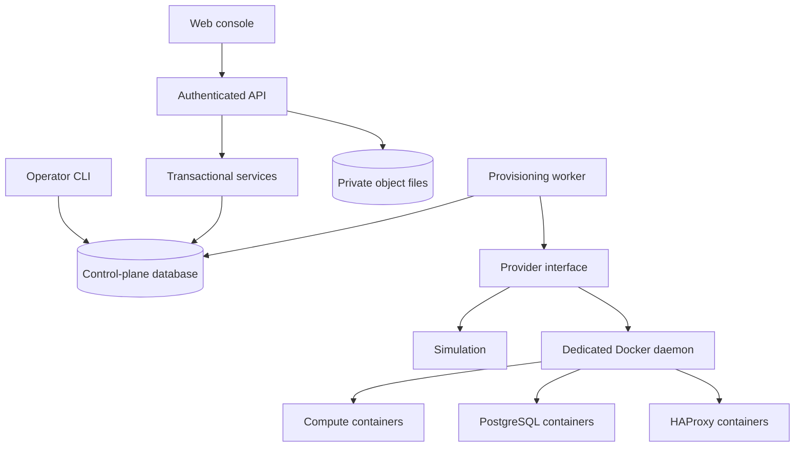
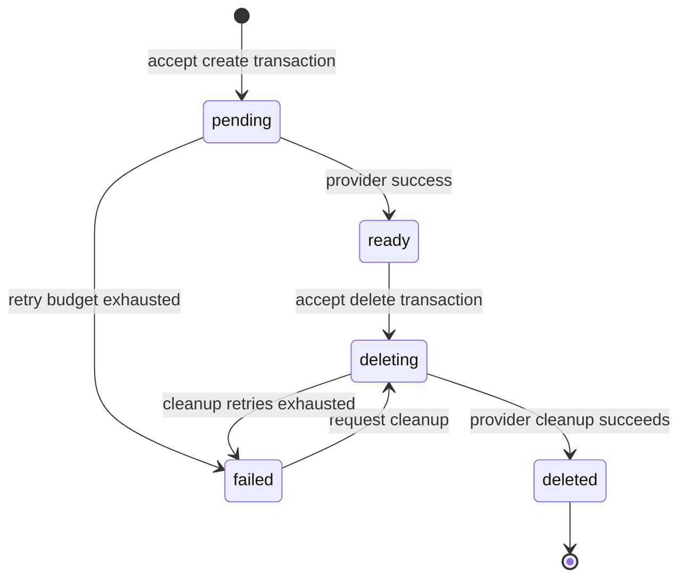

# CloudER architecture

Status: engineering preview, schema v2. Single-host reference implementation; not an enterprise production release.

## System boundaries

The code is a modular monolith with two independently runnable processes. A single database transaction is valuable at this stage: splitting resource state, authorization, quotas, and job publication into microservices would introduce distributed consistency problems without measured scale requiring it.

| Module | Responsibility | Forbidden dependency |
|---|---|---|
| `app.py`, `routes.py`, `storage.py` | HTTP validation, authentication integration, serialization | Runtime socket access |
| `security.py` | Hashed API keys and role checks | Browser-supplied tenant identity |
| `services.py` | Tenant-scoped resource lifecycle, quotas, idempotency, audit | Runtime effects inside a database transaction |
| `models.py`, `db.py` | SQL persistence and versioned schema migrations | Implicit schema changes on API startup |
| `worker.py` | Durable job claim, retries, lease recovery, completion fencing | Request-scoped work queues |
| `providers.py` | Idempotent runtime reconciliation | Arbitrary images, host paths, commands, or target addresses supplied by tenants |
| `static/` | Console rendering and API interaction | Authorization decisions as a security boundary |

## Resource lifecycle and invariants

1. Every owned row is queried using the authenticated tenant, including secrets, operations, objects, and keys. Foreign-tenant resource IDs return 404.
2. A tenant write lock serializes quota changes, duplicate-name checks, target dependency checks, and resource mutations. This intentionally trades per-tenant write throughput for simple invariants.
3. Resource, operation, idempotency record, and request audit event commit in one transaction. The HTTP dependency closes its transaction **before** returning success.
4. Idempotency keys are tenant-scoped and bind to a canonical request fingerprint. Same key + different payload returns 409. Keys are currently retained indefinitely; retention is a future explicit migration/policy.
5. Jobs are at-least-once. PostgreSQL workers use `FOR UPDATE SKIP LOCKED`; conditional claim updates protect the local SQLite path. Work occurs outside the database transaction.
6. Claims have a unique lease token. Renewal and completion require the same token and an unexpired lease, fencing stale database writes. Container names are stable resource UUIDs, so retrying creation reconciles the same container.
7. Retry delay grows exponentially to 60 seconds, with four attempts by default. Expired running claims can be recovered. Runtime calls time out after 20 seconds; the default lease is 180 seconds and renews every 10 seconds during provider execution. Renewal stops at a 600-second execution deadline or on uncertain ownership; late results are discarded. This cannot cancel in-flight Docker effects.
8. API success means accepted intent. `ready` means the provider observed the container process running after creation. There is no continuous drift reconciliation or application readiness certification yet.

Fencing prevents stale control-plane writes, not arbitrary stale effects in a non-fencing Docker daemon. Current operations on a resource cannot overlap create/delete through the API, and provider effects are idempotent. A future scheduler or mutable resource spec needs generation-aware runtime reconciliation and stronger fencing before adding automatic failover.

## Storage and secrets

Object names are logical SQL keys; they are never concatenated into disk paths. Blobs use tenant UUID + SHA-256 paths, are atomically renamed, and have file and directory fsync before metadata commit. Downloads verify the hash. Quotas use logical bytes and a tenant lock. Uploads are bounded (10 MiB default) and currently buffered in memory.

A failed SQL commit can leave an unreferenced blob. Replacements and deletes retain old blobs deliberately so readers cannot race deletion. **Physical usage is not bounded by the logical quota.** Monitor free disk space; orphan collection must run offline after stopping API/worker and taking backups. An online collector needs generation/grace-period rules. Multipart upload, S3 API compatibility, replication, and object versioning are not implemented.

Secret values use Fernet authenticated encryption with an operator-managed key; API tokens use SHA-256 digests of high-entropy random tokens. Database passwords are generated once and encrypted before provisioning, preserving credentials through retries. Secret versions are counters, not a historical version store. Database credential rotation is blocked until an adapter can coordinate SQL password changes with secret updates. A database administrator or Docker administrator remains trusted; Docker configuration includes the database password. This is not a KMS or Vault replacement.

## Runtime and networking

The catalog currently offers nginx-unprivileged, PostgreSQL 17 Alpine, and HAProxy 3.0 Alpine. The operator pre-pulls images. Tenants cannot submit Docker parameters or arbitrary images. Containers use a non-root UID, all Linux capabilities dropped, PID/memory/CPU limits, read-only root filesystems, and no-new-privileges. PostgreSQL receives its named data volume and writable runtime tmpfs. HAProxy writes generated configuration into `/tmp` at startup.

Each tenant receives an internal Docker network. Workloads in the same tenant may communicate. Load-balancer targets must be ready compute resources in that tenant. Each load balancer also joins a separate non-internal ingress network dedicated to its tenant so Docker can publish its port. Compute and databases remain on the internal tenant network. Load-balancer ingress is bound to host loopback with an allocated port; remote HTTPS ingress is not implemented. API/metadata live on a separate internal Compose control network; only the API also joins the Compose ingress network. The Docker adapter belongs on a dedicated host/VM; socket access is powerful even with a read-only mount. Containers are not a strong boundary for hostile tenants. MicroVMs or an appropriately hardened orchestrator are future work.

Provider selection is deployment configuration. Do not switch provider mode with unfinished operations; drain jobs and use a fresh workspace for a different mode. API and worker must run matching code/configuration and encryption keys. Retired tenant networks currently require operator cleanup after verifying no workloads remain.

## Billing and monitoring

Billing always simulates cost: elapsed seconds between provisioning readiness and deletion, multiplied by a synthetic integer microUSD rate. It includes downtime until deletion and excludes storage, egress, tax, and discounts. No payment integration or durable usage ledger is claimed. A real ledger needs idempotent usage events, immutable price versions, settlement windows, and reconciliation.

Metrics expose tenant resource/job counts and oldest unfinished operation age. Structured HTTP logs include route templates, status, latency, and generated request IDs; they omit request bodies, tokens, query strings, and raw paths. Audit events are transactionally recorded for accepted mutations and secret reads. They are append-only through the API, **not tamper-proof against database administrators**. Denied request auditing, OpenTelemetry propagation, host metrics, dashboards, and paging integrations remain planned.

Operator-only `clouder worker-health` reports aggregate live/busy/stale/stopped workers for the configured provider and exits nonzero if none are live. Fresh busy heartbeats must match an active, unexpired claim. This is liveness, not queue capacity or workload health. SIGTERM drains the current call and keeps renewing until it finishes or exceeds its deadline. [ADR 0003](adr/0003-worker-liveness-and-renewable-leases.md) records failure semantics, clock synchronization assumptions, and limits.

## Persistence and deployment

PostgreSQL is the intended multi-process deployment backend. SQLite is a local development convenience, not a scale claim. Explicit CLI migrations are protected by a PostgreSQL advisory lock or SQLite `BEGIN IMMEDIATE`. Schema v2 adds worker heartbeats to the original v1 tables in the same transaction as its version marker. Existing resource data is preserved. API readiness and worker startup require the matching schema. Upgrades stop writers; rollback restores a pre-upgrade snapshot (see the runbook). Future changes require explicit forward migrations.

The default Compose stack runs API, worker, PostgreSQL, and a one-shot migration. API binds only to `127.0.0.1:8000`. Simulation requires no runtime socket. The Docker override is an opt-in dedicated-host development configuration. No Kubernetes, multi-region scheduling, live migration, automatic failover, or production availability claim is made.

## Reference sources

- [Docker Engine security](https://docs.docker.com/engine/security/) and [rootless mode](https://docs.docker.com/engine/security/rootless/).
- [PostgreSQL SELECT locking semantics](https://www.postgresql.org/docs/17/sql-select.html).
- [Compose startup ordering](https://docs.docker.com/compose/how-tos/startup-order/).
- [Official PostgreSQL container data-volume behavior](https://github.com/docker-library/docs/blob/master/postgres/README.md).
